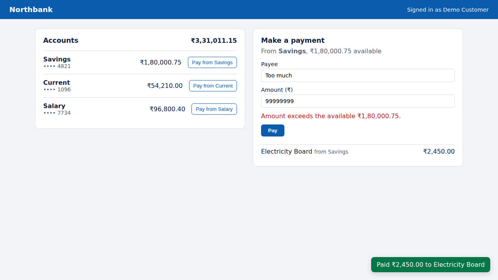
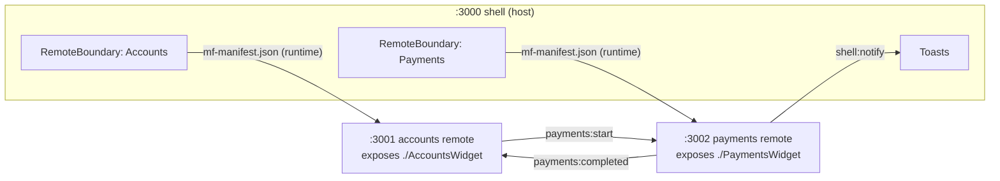

# Micro-Frontend Banking Platform

A banking UI split into independently built and deployed micro-frontends using
**Module Federation 2.0** on **Rsbuild**, with React 19 and TypeScript.



> Northbank is a fictional bank; all data is synthetic.

## What it demonstrates

| Concept | Where |
|---|---|
| Runtime composition: the shell loads remotes from `mf-manifest.json` at runtime | `apps/shell/rsbuild.config.ts` |
| Independent deploys: remote URLs come from env vars, so a remote ships or rolls back without rebuilding the shell | `ACCOUNTS_REMOTE`, `PAYMENTS_REMOTE` |
| Shared singletons: one React instance across all bundles | `shared` config in every app |
| Fault isolation: a remote that's down or throws shows a fallback with Retry; the rest keeps working | `apps/shell/src/RemoteBoundary.tsx` |
| Non-blocking startup: `shareStrategy: 'loaded-first'` so an unreachable remote can't block the shell | `apps/shell/rsbuild.config.ts` |
| Typed cross-MFE contract: MFEs never import each other; they talk through typed window events | `packages/contracts/src/events.ts` |
| Style isolation + shared design tokens: CSS Modules per MFE, tokens as CSS custom properties from the shell | `*.module.css`, `apps/shell/src/tokens.css` |
| Standalone mode: each remote runs on its own for team-level development | `apps/*/src/bootstrap.tsx` |

## Architecture



**Flow:** click *Pay from Savings* in Accounts → Accounts publishes `payments:start` → Payments pre-fills the
source account → on submit Payments validates against the available balance and publishes `payments:completed`
→ Accounts updates the balance and the shell shows a toast. No MFE imports another's code.

## Run

```bash
npm install
npm run dev        # shell :3000, accounts :3001, payments :3002
```

Open http://localhost:3000. Stop the payments dev server to watch the shell isolate the failure.

```bash
npm test           # event-bus contract tests
npm run typecheck
npm run build      # production builds of all three apps
```

## Design decisions
1. **Window events over a shared store.** A shared Redux store couples release cycles, because every MFE must
   agree on its shape and version. Typed events keep the contract small and explicit.
2. **Manifest over `remoteEntry.js`.** The manifest carries metadata (build version, shared deps) and enables
   runtime features like preloading.
3. **Error boundary per remote.** Failure is expected in distributed frontends; each region degrades alone.
4. **`loaded-first` share strategy.** The default strategy fetches every remote at startup to compare shared
   versions, which lets one offline remote blank the whole page.

## Next steps
- Deploy each app to its own Vercel project and set the remote env vars on the shell.
- Add a Playwright suite for the cross-MFE flow in CI.
- Version the event contract (`payments:completed@v2`) and support both versions during migrations.
